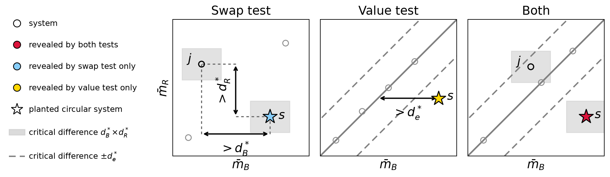

# circularity-reveal

Reveal circular systems in LLM-judge evaluation from a pair of nugget-bank
leaderboards.

An LLM judge is circular when its nugget bank shares its source with one of the
systems it grades. Such a system scores higher under that nugget bank than its
quality warrants. This package takes the per-topic scores of every system under
a tested nugget bank and under a reference nugget bank, runs two independent
tests, and plots the outcome.



## The Two Tests

**Swap test.** Does the reference nugget bank confirm the wins a system obtains
under the tested nugget bank? A win is counted whenever a system beats another
by more than the critical difference of the tested leaderboard. A system is
revealed when the reference certifies the opposite ordering, or when the number
of its unconfirmed wins passes a threshold, by default 20 percent of all
systems. The swap test makes no assumption about how the two score scales
relate. It therefore needs a diverse pool of comparison systems.

**Value test.** Is the tested score of a system higher than its reference score
predicts? A robust affine fit by Theil-Sen regression on the system means
predicts the tested score of each system from its reference score. A system is
revealed when its mean residual above that fit exceeds a critical difference.
This critical difference is calibrated on residuals around Theil-Sen lines fit
within each topic, so that the margin reflects topic-to-topic scatter instead of
the lack of fit of the single slope. The value test assumes that the two nugget
banks are affinely related. It detects inflation at any rank, including the top
rank.

Both critical differences are obtained with the randomized Tukey HSD permutation
test and are computed on the same shared topics, which `align()` enforces.

## Install

### Install from PyPI

```bash
pip install circularity-reveal              # core (numpy)
pip install "circularity-reveal[plot]"      # with the result plot (matplotlib)
pip install "circularity-reveal[autojudge]" # with the CLI's auto-judge eval-file reader
```

To depend on it from another package, add it to the `pyproject.toml` of that
package:

```toml
[project]
dependencies = [
    "circularity-reveal>=1.0.0",
    # or with extras: "circularity-reveal[plot,autojudge]>=1.0.0",
]
```

### Install from Source

```bash
git clone https://github.com/TREMA-UNH/circularity-reveal.git
cd circularity-reveal
pip install -e ".[test,plot]"
```

To depend on the source repository from another package, use this entry in its
`pyproject.toml`:

```toml
[project]
dependencies = [
    "circularity-reveal @ git+https://github.com/TREMA-UNH/circularity-reveal.git",
]
```

## License

MIT, see `LICENSE`.

## Use as a Library

Scores are passed in memory as `{system: {topic: score}}`, one dictionary per
nugget bank. `reveal()` aligns the two dictionaries and runs both tests in one
call:

```python
from circularity_reveal import reveal

result = reveal(tested_scores, reference_scores)   # aligns and runs both tests
result.revealed                 # frozenset of systems revealed by either test
result.swap.revealed            # swap test alone; d_tested, d_reference, counts
result.value.revealed           # value test alone; slope, intercept, d_residual
```

Each step is also available on its own and operates on an aligned pair of
`ScoreMatrix` objects:

```python
from circularity_reveal import align, swap_test, value_test, plot_reveal

tested, reference = align(tested_scores, reference_scores)
swap = swap_test(tested, reference)
value = value_test(tested, reference)
plot_reveal(tested, reference, swap, value,
            planted=known_circular_systems,
            xlabel="tested bank", ylabel="reference bank")
```

`SwapResult` holds the two critical differences and, for each system, the
number of unconfirmed and contradicted wins. `ValueResult` holds the fit, the
residual critical difference, and the residual of each system.

## Command Line

With the `[autojudge]` extra, the CLI reads auto-judge ir_measures eval files
directly. `--measure` selects one measure key, given without its nugget bank
name:

```bash
circularity-reveal \
  --tested    ours/judge/both.eval.txt \
  --reference pool/judge/both.eval.txt \
  --measure   AVG_GRADE__rubric \
  --plot reveal.png --json reveal.json
```

The CLI prints the systems revealed by each test and the critical differences.
The options `--alpha`, `--theta`, `--perm`, and `--seed` adjust the tests, and
`--format` selects a different eval file format.

## Tests

```bash
pip install -e .[test,plot]
pytest
```
